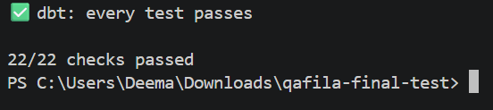

# Testing on New Data

## Test Setup

The project was cloned from GitHub into a fresh directory, and the required dependencies were installed using `uv sync`.

New test data was generated using seed 11:

```bash
uv run python tools/make_data.py --seed 11 --out data_11
```

The pipeline was then run using the new dataset and a separate warehouse:

```bash
uv run python run.py --data-dir data_11 --warehouse warehouse_11
```

## Results

The pipeline completed successfully on the new dataset.

- dbt: 11 tests passed.
- Contract checks: 22/22 passed.
- Product cost history: 632 rows.
- Weekly margin: 165 rows.
- Price quarantine: 7 rows.

The pipeline was run a second time with the same inputs. All three Iceberg tables reported no changes, confirming that the rerun did not publish unnecessary updates.

The contract checks were run again after the second run, and all 22 checks passed.

Test data and generated warehouse files were kept local and were not committed to the repository.

